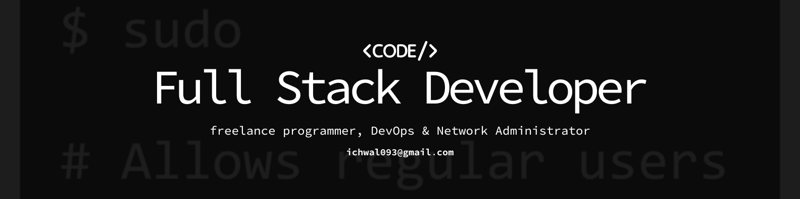

# Hi there, I'm Ichwal 👋
### Full Stack Developer & DevOps Engineer

 

---

### 👨‍💻 About Me

- 📍 Based in **Makassar, Indonesia**
- 🎓 Informatics Engineering student at **Universitas Muslim Indonesia** (GPA 3.90)
- 🚀 Specialized in **Full-Stack Engineering** (Laravel, Next.js, React, TypeScript) and **DevOps / Cloud Infrastructure** (Docker, CI/CD, Ubuntu Server, Nginx, GCP)
- ☁️ Holder of **15+ Google Cloud Skill Badges** with hands-on GenAI & Vertex AI integration
- 🌐 Cisco Certified in **Network Defense** & experienced in Linux Systems Administration
- 💼 Available for freelance projects, technical collaborations, and software/DevOps roles

---

### 🛠️ Tech Stack & Capabilities

#### ☁️ DevOps & Cloud Infrastructure

  
  
  
  
  
  
  
  

#### 💻 Full-Stack Development

  
  
  
  
  
  
  
  
  
  

---

### 📊 GitHub Stats & Performance

  
  

 

  

---

### 🐍 GitHub Contributions Snake

  <picture>
    <source media="(prefers-color-scheme: dark)" srcset="https://raw.githubusercontent.com/ichwalM/ichwalM/output/snake.svg?v=2">
    <source media="(prefers-color-scheme: light)" srcset="https://raw.githubusercontent.com/ichwalM/ichwalM/output/snake.svg?v=2">
    
  </picture>

---

  Built with ❤️ by <a href="https://walldev.my.id"><b>Ichwal (Walldev)</b></a> · Makassar, Indonesia

